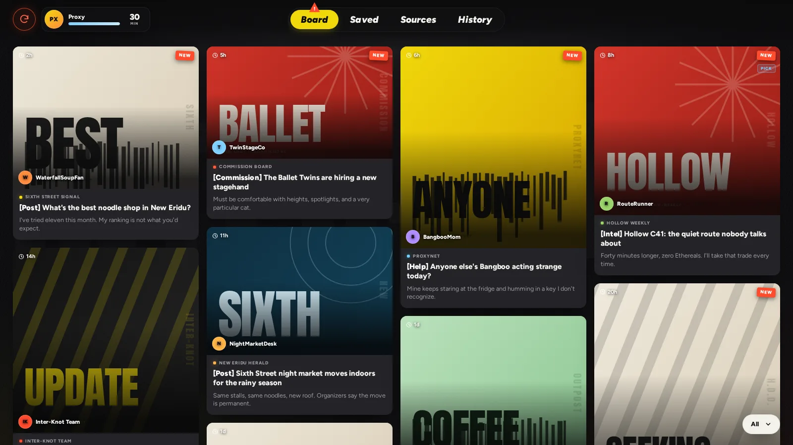

# Inter-Knot Board

**A static, board-style RSS reader inspired by the Inter-Knot board in _Zenless Zone Zero_.**  
An unofficial fan project and a tech demo — not a service.

[Live demo](https://albertthegr8r.github.io/inter-knot-board/) ·
[Architecture](docs/ARCHITECTURE.md) ·
[Feed notes](docs/FEEDS.md) ·
[License](LICENSE)



## What this is

Inter-Knot Board is a single-page reader that treats feeds like posts pinned to a
board: a masonry wall, bracketed tags, a floating header, a mindful session
timer, and a post view that opens over a blurred board.

It is a static site. There are no accounts, no backend, no analytics, and no
tracking. Your feed list, reading state, and timer live in your browser.

**Status: v0.1.0 — UI demo.** The board, post view, sections, scoped filter,
mindful timer, adaptive pagination, keyboard basics, responsive layout, and
generated poster art work. The feed pipeline (RSS/Atom, OPML, local proxy,
FreshRSS) is the next milestone. Until then the board uses clearly in-world demo
posts.

## Mindful by default

The old level and XP bar are gone. The profile chip now shows the current reading
cap and a timer that drains only while you browse the board. The default is
**30 minutes**. When it runs out, `Load more` pauses and the Proxy sheet offers
a refill. Leaving the board recharges it after a five-minute grace period. The
cap is adjustable, and an explicit Unlimited switch is there for the weekend.

The board never auto-loads. `Load more` adds roughly five board viewports’ worth
of cards, calculated from the column count and measured card heights. There are
no infinite-scroll or engagement-ranking mechanics. Read-on-scroll is opt-in and
uses the whole card plus a dwell period; the unread filter never auto-marks, so
it stays a queue.

## What works today

- Order-preserving masonry: 1 → 2 → 3 → 4 → 5 → 8 columns, depending on width.
- Post cards with a clock/time badge, read-state title color, author strip, tag,
  title, and a one-line preview.
- Deterministic generated posters for posts without images (8 palettes, 5
  patterns) — no grey placeholders.
- Post dialog: blurred backdrop, source bar, save toggle, red close button,
  optional system note, poster/media pane, scrollable article, `Expand`, quote
  card, tags, comments with floor badges.
- Board / Saved / Sources / History sections. Opening a post marks it read and
  files it in History; Saved is a real library, not demo state.
- Bottom-right filter: All / Unread / Read plus source scope, with the scope
  controls pinned nearest the pill.
- Mindful timer and Proxy sheet: cap choices, Unlimited, refill, compact density,
  read-on-scroll.
- Adaptive `Load more`: about five board viewports per batch, never an infinite
  scroll.
- Keyboard: cards are focusable; `Enter`/`Space` opens; the dialog traps focus
  and closes on `Escape`.
- Static build with type-checking and a production CSP.


## Quick start

Requires [Bun](https://bun.sh/) 1.4+.

```bash
bun install
bun run dev      # http://localhost:5173
bun run check    # type-check + tests + production build
bun run preview  # preview the production build
```

## How feeds will work

A static site cannot bypass the browser's CORS rules. Direct feeds are the
default and only mode that works without help; feeds that do not send
`Access-Control-Allow-Origin` need a local proxy or a reader backend.

| Mode                 | Works on GitHub Pages             | Setup                                         |
| -------------------- | --------------------------------- | --------------------------------------------- |
| **Direct** (default) | Only CORS-enabled feeds           | None — planned v0.2.0                         |
| **Local proxy**      | Yes, from `127.0.0.1`             | Run the small Bun proxy — planned v0.3.0      |
| **FreshRSS**         | Yes                               | Your instance + API password — planned v0.4.0 |
| **Miniflux**         | Usually; may need a reverse proxy | Your instance + API token — planned v0.4.0    |
| **Lemmy**            | Same as direct                    | Native community/user RSS — planned v0.5.0    |

Only the UI demo is implemented in v0.1.0; the rows above are documented
contracts, not shipped features. The `Sources` section is the shell that direct
RSS fills in v0.2.0. Folder management is deliberately deferred until the
FreshRSS phase, when imported categories need a review flow.

The planned daily-use setup is **GitHub Pages + local proxy + browser storage**,
with FreshRSS or Miniflux as optional sync backends. The app will never ship a
public CORS proxy or ask you to paste feed credentials into a third-party
service. See [docs/FEEDS.md](docs/FEEDS.md) for the contract and security
requirements.

## Deploy

The site is plain static output in `dist/`. The included
[Pages workflow](.github/workflows/pages.yml) builds and deploys on every push to
`main`:

- `https://albertthegr8r.github.io/inter-knot-board/`
- Assets use relative URLs, so the same build also works on a custom domain or a
  local static server.

GitHub Pages cannot set response headers. The production CSP is delivered as a
meta tag; `frame-ancestors`, HSTS, and `X-Frame-Options` are not available. This
is documented in [docs/DEPLOYMENT.md](docs/DEPLOYMENT.md) rather than papered
over.

## Documentation

- [Architecture](docs/ARCHITECTURE.md) — components, data flow, transport
  interface.
- [Feeds and CORS](docs/FEEDS.md) — direct fetch, local proxy, FreshRSS,
  Miniflux.
- [Deployment](docs/DEPLOYMENT.md) — GitHub Pages, CSP limits, local proxy.
- [Lemmy](docs/LEMMY.md) — native RSS, read-only scope, comments.
- [Roadmap](docs/ROADMAP.md) — what is next, and what is deliberately out of
  scope.
- [Contributing](CONTRIBUTING.md) · [Security](SECURITY.md) ·
  [Code of Conduct](CODE_OF_CONDUCT.md).

## How this was built

This is a tech demo, not production software. The design study, direction, and
review are human; most of the implementation was written with AI assistance. It
is intentionally small and will have rough edges. AI-assisted contributions are
welcome when they are disclosed and verified.

## License and disclaimer

MIT for the original code and documentation. Zenless Zone Zero and Inter-Knot
are trademarks of HoYoverse. This is an unofficial fan project, not affiliated
with or endorsed by HoYoverse. No game assets or reference screenshots are
included. See [DISCLAIMER.md](DISCLAIMER.md) and
[THIRD_PARTY_NOTICES.md](THIRD_PARTY_NOTICES.md). Bundled license texts are served
at `/licenses/`.
