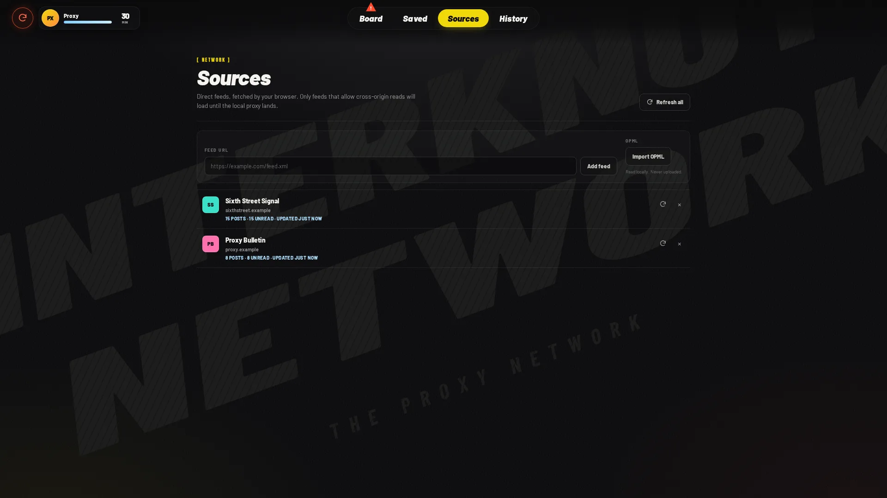
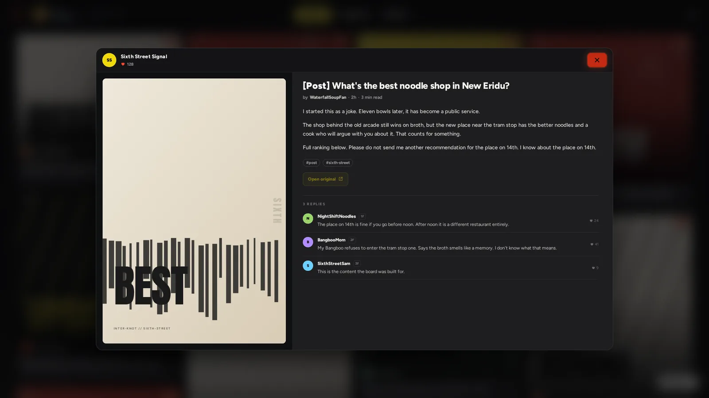
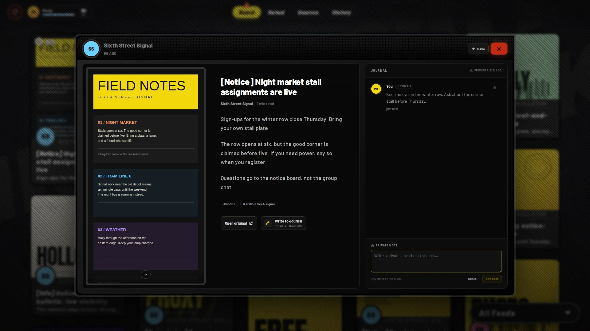

# Inter-Knot Board

**A static, board-style RSS reader inspired by the Inter-Knot board in _Zenless Zone Zero_.**  
An unofficial fan project and a tech demo — not a service.

[Live demo](https://albertthegr8r.github.io/inter-knot-board/) ·
[Architecture](docs/ARCHITECTURE.md) ·
[Feed notes](docs/FEEDS.md) ·
[License](LICENSE)


_Documentation screenshots use a local fixture feed with original copy; no
third-party article art is bundled._

## What this is

Inter-Knot Board is a single-page reader that treats feeds like posts pinned to a
board: a masonry wall, bracketed tags, a floating header, a mindful session
timer, and a post view that opens over a blurred board.

It is a static site. There are no accounts, no backend, no analytics, and no
tracking. Your feed list, reading state, and timer live in your browser.

**Status: v0.2.1 — post reader.** Add a feed URL or import a FreshRSS/OPML
export. The board parses RSS 2.0, Atom, RDF, and JSON Feed in the browser,
caches posts in IndexedDB, and feeds the sections, filters, mindful timer, and
poster fallback.

The post view now has a two-column reading layout by default and a three-column
layout when comments or private journal notes are present. Long informational
images scroll inside their card instead of being cropped, and the Journal filter
collects posts with private field notes. The dedicated Journal tab is still in
design.

Direct fetch is the only transport in this release. A static site cannot bypass
CORS, so feeds that do not send `Access-Control-Allow-Origin` will show a clear
error in **Sources** until the local proxy lands. The board starts empty: there
is no demo content and no bundled starter list.

## Mindful by default

The old level and XP bar are gone. The profile chip now shows the current reading
cap and a timer that drains only while you browse the board. The default is
**30 minutes**. When it runs out, `Load more` pauses and the Proxy sheet offers
a refill. Leaving the board recharges it after a five-minute grace period. The
cap is adjustable, and an explicit Unlimited switch is there for the weekend.

The board never auto-loads. `Load more` adds roughly five board viewports’ worth
of cards, calculated from the column count and measured card heights. There are
no infinite-scroll or engagement-ranking mechanics. Read-on-scroll is opt-in and
uses the whole card plus a dwell period; the unread filter never auto-marks, so
it stays a queue.

## What works today

- **Direct feeds.** RSS 2.0, Atom, RDF, and JSON Feed, including YouTube-style
  `media:` thumbnails and escaped HTML. No server, no account, no third-party
  proxy.
- **Sources manager.** Add a URL, import OPML, refresh one feed or all, remove a
  feed, retry failed feeds, or clear the failed ones. Every row shows its last
  fetch, unread count, and exact error.
- **CORS honesty.** A blocked feed keeps its cached posts and explains that the
  browser could not read it. The app never silently routes it through a third
  party.
- **Article cache.** IndexedDB stores feeds and posts; read, saved, and opened
  state live in their own record so cache pruning cannot erase them.
- **Real media.** Feed images take precedence on cards and in the post view;
  broken images and image-less posts fall back to the deterministic generated
  posters.
- **Sanitized article HTML.** Scripts, event handlers, forms, iframes, and
  unsafe URLs are stripped. Links open the original source in a new tab.
- **Two- and three-column post reader.** Image card plus article by default;
  a third rail for comments or private notes when one exists.
- **Private Journal.** Write local field notes on a post, read them in the
  Journal rail, filter the board by Journal, and delete notes. Nothing is
  posted or synced; the dedicated Journal tab is still in design.
- **Scrollable post images.** Long strips keep their full width and scroll with
  sharp fades and up/down arrows. Short images fill the card as before.
- Order-preserving masonry: 1 → 2 → 3 → 4 → 5 → 8 columns, depending on width.
- Static procedural Inter-Knot masthead behind the wall, hatched and rotated
  without a marquee or game texture.
- Post cards with a clock/time badge, read-state title color, author strip, tag,
  title, and a one-line preview.
- Post dialog: blurred hatched backdrop, three-corner window, two-border avatar,
  image card, article card, comments/Journal rail, save toggle, and original
  link.
- Board / Saved / Sources / History sections. Opening a post marks it read and
  files it in History.
- Bottom-right filter: All / Unread / Read / Journal plus source scope, with
  the scope controls pinned nearest the pill.
- Mindful timer and Proxy sheet: cap choices, Unlimited, refill, compact density,
  read-on-scroll.
- Adaptive `Load more`: about five board viewports per batch, never an infinite
  scroll.
- Keyboard: cards are focusable; `Enter`/`Space` opens; the dialog traps focus
  and closes on `Escape`.
- Static build with type-checking and a production CSP.







## Quick start

Requires [Bun](https://bun.sh/) 1.4+.

```bash
bun install
bun run dev      # http://localhost:5173
bun run check    # type-check + tests + production build
bun run preview  # preview the production build
```

## How feeds work

A static site cannot bypass the browser's CORS rules. Direct feeds are the
default and only mode that works without help; feeds that do not send
`Access-Control-Allow-Origin` need a local proxy or a reader backend.

| Mode                 | Works on GitHub Pages             | Setup                                         |
| -------------------- | --------------------------------- | --------------------------------------------- |
| **Direct** (default) | Only CORS-enabled feeds           | None — shipped in v0.2.0                      |
| **Local proxy**      | Yes, from `127.0.0.1`             | Run the small Bun proxy — planned v0.3.0      |
| **FreshRSS**         | Yes                               | Your instance + API password — planned v0.4.0 |
| **Miniflux**         | Usually; may need a reverse proxy | Your instance + API token — planned v0.4.0    |
| **Lemmy**            | Same as direct                    | Native community/user RSS — planned v0.5.0    |

The Sources section is the real manager in v0.2.0. Folder management is
deliberately deferred until the FreshRSS phase, when imported categories need a
review flow. OPML folders are preserved on import but not shown yet.

The planned daily-use setup is **GitHub Pages + local proxy + browser storage**,
with FreshRSS or Miniflux as optional sync backends. The app will never ship a
public CORS proxy or ask you to paste feed credentials into a third-party
service. See [docs/FEEDS.md](docs/FEEDS.md) for the contract and security
requirements.

## Deploy

The site is plain static output in `dist/`. The included
[Pages workflow](.github/workflows/pages.yml) builds and deploys on every push to
`main`:

- `https://albertthegr8r.github.io/inter-knot-board/`
- Assets use relative URLs, so the same build also works on a custom domain or a
  local static server.

GitHub Pages cannot set response headers. The production CSP is delivered as a
meta tag; `frame-ancestors`, HSTS, and `X-Frame-Options` are not available. This
is documented in [docs/DEPLOYMENT.md](docs/DEPLOYMENT.md) rather than papered
over.

## Documentation

- [Architecture](docs/ARCHITECTURE.md) — components, data flow, transport
  interface.
- [Feeds and CORS](docs/FEEDS.md) — direct fetch, local proxy, FreshRSS,
  Miniflux.
- [Deployment](docs/DEPLOYMENT.md) — GitHub Pages, CSP limits, local proxy.
- [Lemmy](docs/LEMMY.md) — native RSS, read-only scope, comments.
- [Roadmap](docs/ROADMAP.md) — what is next, and what is deliberately out of
  scope.
- [Contributing](CONTRIBUTING.md) · [Security](SECURITY.md) ·
  [Code of Conduct](CODE_OF_CONDUCT.md).

## How this was built

This is a tech demo, not production software. The design study, direction, and
review are human; most of the implementation was written with AI assistance. It
is intentionally small and will have rough edges. AI-assisted contributions are
welcome when they are disclosed and verified.

## License and disclaimer

MIT for the original code and documentation. Zenless Zone Zero and Inter-Knot
are trademarks of HoYoverse. This is an unofficial fan project, not affiliated
with or endorsed by HoYoverse. No game assets or reference screenshots are
included. See [DISCLAIMER.md](DISCLAIMER.md) and
[THIRD_PARTY_NOTICES.md](THIRD_PARTY_NOTICES.md). Bundled license texts are served
at `/licenses/`.
